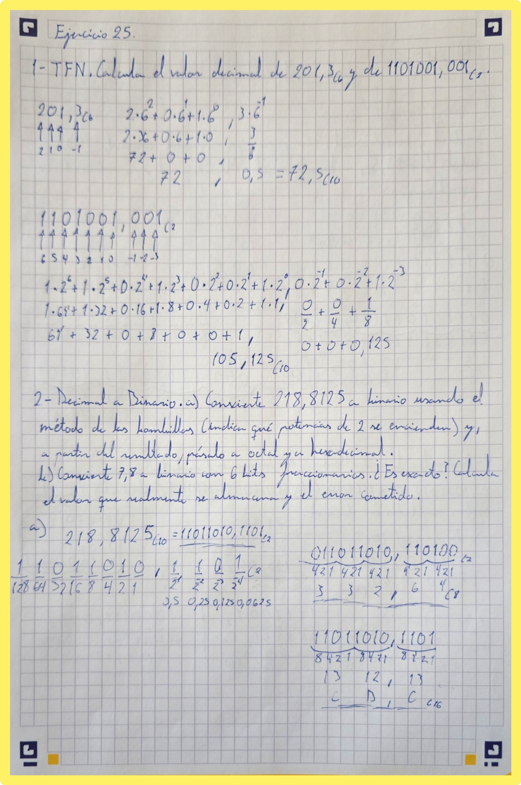
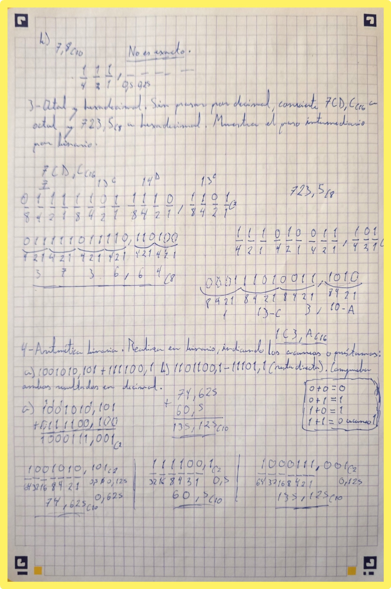
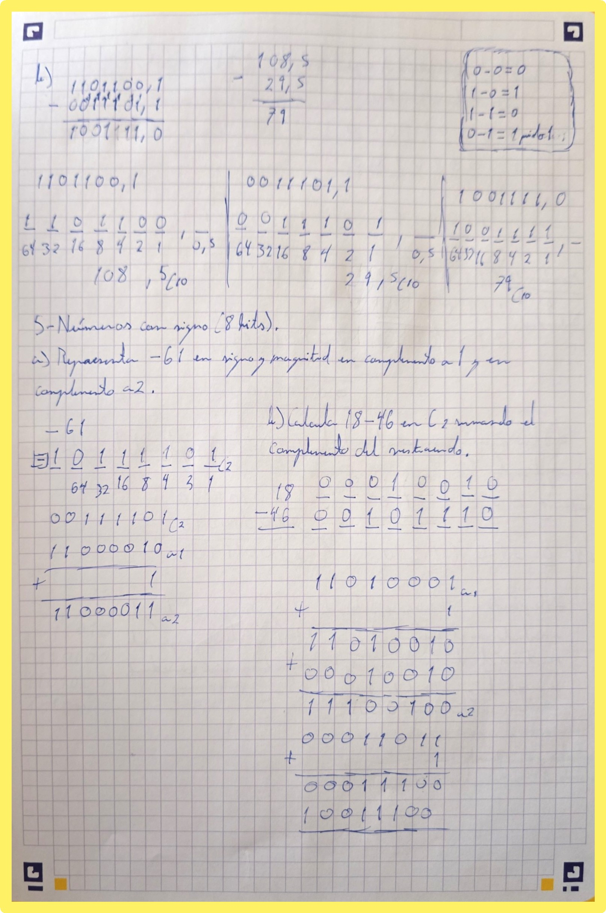
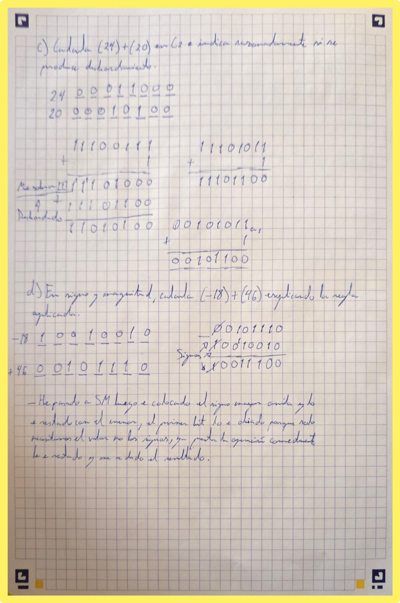
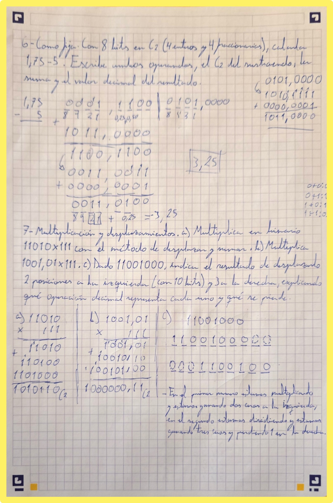
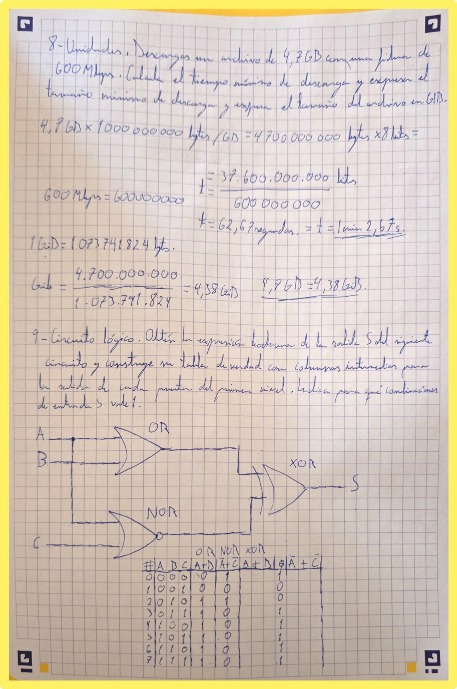
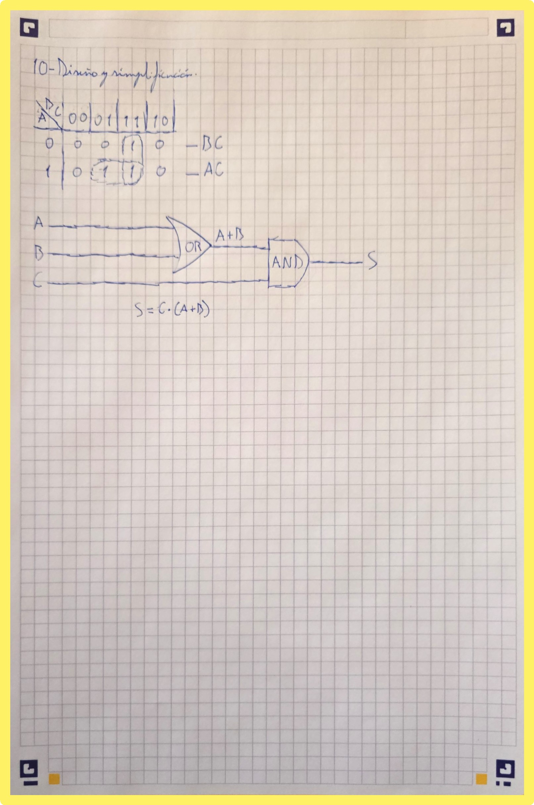

# Relacion de Ejercicios de Binario y de Puertas Logicas

> @autor: Ferro-cmd

## Relacion 25-

### Ejercicio 1
- Apartado a solucion: $72,5_{(10}$
- Apartado b solucion: $105,125_{(10}$

### Ejercicio 2
- Apartado a solucion: $218,8125_{(10} = 11011010,1101_{(2}$ (Octal: $332,64_{(8}$, Hexadecimal: $13\text{D,C}_{(16}$)
- Apartado b solucion: No es exacto ($7,796875$).

### Ejercicio 3
- Solucion octal y hexadecimal: $7CD,C_{(16} = 3736,64_{(8}$ y $723,5_{(8} = 1C3,A_{(16}$

### Ejercicio 4
- Apartado a solucion: $1000111,001_{(2}$ ($135,125_{(10}$)
- Apartado b solucion: $1001111,0_{(2}$ ($79_{(10}$)

### Ejercicio 5
- Apartado a solucion: $-61$ en SM ($11001101$), $C_1$ ($00111101$) y $C_2$ ($11000011$)
- Apartado b solucion: $18 - 46 = 10011100_{(2}$
- Apartado c solucion: $(24) + (20) = 00101100_{(2}$ (Sin desbordamiento)
- Apartado d solucion: $(-18) + (46) = 00011100_{(2}$

### Ejercicio 6
- Solucion: $1,75 - 5 = -3,25$ ($1011,0000_{(2}$ en $C_2$)

### Ejercicio 7
- Apartado a solucion: $1010110_{(2}$
- Apartado b solucion: $1000000,11_{(2}$
- Apartado c solucion: Izquierda ($1100100000_{(2}$), Derecha ($0001100100_{(2}$)

### Ejercicio 8
- Solucion: Tiempo minimo = $1\text{ min } 2,67\text{ s}$ ($62,67\text{ s}$); Tamano = $4,38\text{ GiB}$

### Ejercicio 9
- Solucion: Expresion booleana y tabla de verdad (S vale 1 para las combinaciones 0, 3, 4, 5, 6 y 7).
| # | A | B | C | OR | NOR | XOR | S |
|---|---|---|---|---|---|-----|---|
| 0 | 0 | 0 | 0 | 0 | 1 | 1 | 1 |
| 1 | 0 | 0 | 1 | 0 | 0 | 0 | 0 |
| 2 | 0 | 1 | 0 | 1 | 1 | 0 | 0 |
| 3 | 0 | 1 | 1 | 1 | 0 | 1 | 1 |
| 4 | 1 | 0 | 0 | 1 | 1 | 1 | 1 |
| 5 | 1 | 0 | 1 | 1 | 0 | 1 | 1 |
| 6 | 1 | 1 | 0 | 1 | 1 | 1 | 1 |
| 7 | 1 | 1 | 1 | 1 | 0 | 1 | 1 |

### Ejercicio 10
- Solución: $S = C \cdot (A + B)$
| A \ BC | 00 | 01 | 11 | 10 |
|:---:|:---:|:---:|:---:|:---:|
| **0** | 0 | 0 | 1 | 0 |
| **1** | 0 | 1 | 1 | 0 |

### Fecha: 15-October-2026
